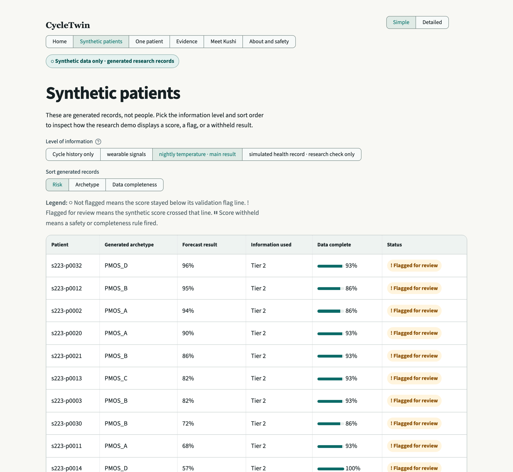
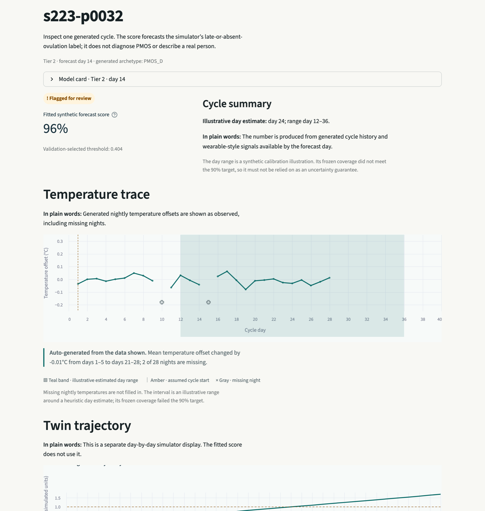
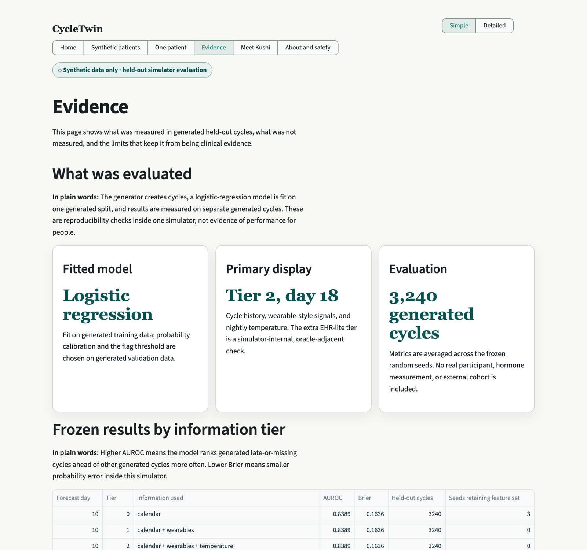
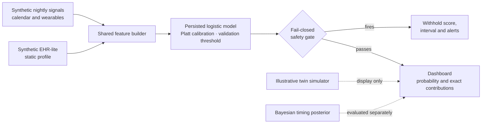

<div align="center">

# CycleTwin

**Forecasting late or absent ovulation from calendar and wearable signals: a synthetic-data research prototype with fail-closed safety gates.**

[](https://github.com/kushagragupta2005/CycleTwin/actions/workflows/ci.yml)
[](LICENSE)
[](requirements.txt)
[](https://streamlit.io)
[](#limitations)

[Quick start](#quick-start) · [How it works](#how-it-works) · [Results](#results) · [Full evaluation](docs/RESULTS.md) · [Limitations](#limitations) · [Pitch deck](deliverables/CycleTwin_pitch_deck.pdf)

</div>

> [!WARNING]
> **Synthetic data only.** Not for diagnosis, contraception, conception planning or treatment decisions. No clinical validity, hormone inference or real-world accuracy is claimed.

<p align="center"></p>

## Overview

Irregular cycles are often noticed late. CycleTwin asks a narrow research question: **can calendar history plus nightly wearable-style signals (temperature, resting heart rate, HRV, steps) flag a cycle whose ovulation comes after day 21, or does not occur, early enough to matter?**

Everything runs on a seeded simulator that mixes PMOS-like and typical archetypes; the development seeds alone hold 3,600 generated people and 21,600 cycles, and the frozen test uses separate reserved seeds. CycleTwin does **not** diagnose PMOS. The project's value is in the evaluation discipline: a predeclared, once-only frozen test, calibrated scores, explicit abstention, and published failure cases.

## Features

- **One persisted prediction path.** Calibrated logistic models (median imputation, scaling, Platt calibration) power the benchmark, cohort, patient and persona views alike. `src/inference.py` returns the probability, the validation threshold and exact additive feature contributions.
- **Fail-closed safety gate.** Explicit rules withhold the score, interval, explanation and alerts instead of guessing: under 18 or early post-menarche, pregnancy-related states, hormonal contraception, abnormal thyroid or prolactin flags, missing safety fields, or wear-time completeness below 75%.
- **Input tiers.** Calendar only → + wearables → + temperature → + EHR-lite, each evaluated separately; richer tiers fall back to calendar when validation shows no Brier gain.
- **Sequential alerts.** At most one alert per cycle, at the earliest safe threshold crossing on days 10, 14 and 18, with no retuning on test data.
- **Uncertainty and robustness.** Conformal classification sets, patient-cluster bootstrap intervals, and sweeps for missing data, sensor drift and timing shift.
- **Clinician-style dashboard** (Streamlit) with plain/detailed language modes, a synthetic cohort, single-patient view, evidence page and a fictional persona walkthrough.
- **Apple Health adapter.** Parses a limited `export.xml` subset in memory; imports are never scored.

## Screenshots

| Single generated record | Evidence page |
|:---:|:---:|
|  |  |

## Quick start

```sh
git clone https://github.com/kushagragupta2005/CycleTwin.git
cd CycleTwin
python3 -m venv .venv && . .venv/bin/activate
python -m pip install -r requirements.txt
streamlit run app.py
```

Then open <http://localhost:8501>. The fitted model artifacts ship with the repository, so no training step is needed.

## How it works



The illustrative twin and the Bayesian posterior never feed the fitted score, threshold, safety gate or alert policy. See [docs/architecture.md](docs/architecture.md) and the [architecture deck](deliverables/CycleTwin_architecture.pdf).

## Results

Frozen evaluation (`frozen-v1` tag): the protocol was committed before the reserved seeds were generated and executed exactly once. Day-18 means across 3 frozen seeds, 3,240 held-out generated cycles per tier:

| Tier | Inputs | AUROC | Brier |
|---:|---|---:|---:|
| 0 | calendar | 0.839 | 0.164 |
| 1 | calendar + wearables | 0.839 | 0.164 |
| 2 | calendar + wearables + temperature | 0.907 | 0.117 |
| 3 | calendar + wearables + temperature + EHR-lite (oracle-adjacent) | 0.907 | 0.117 |

| Check (Tier 2, day 18) | Result |
|---|---|
| Sequential alert precision | 0.730 (missed events 0.289) |
| Median lead time of true alerts | 17 days |
| Conformal classification-set coverage | 0.901 |
| Bayesian timing posterior vs logistic (Brier) | 0.098 vs 0.117 |

### Where it breaks

- On days 10 and 14 the retained model is mostly calendar history; temperature-derived signals only add a clear gain by day 18.
- The heuristic ovulation-day band covered **0.056** of applicable cases and **failed** its coverage check; it is shown as an illustration only.
- With +0.01 °C/day simulated sensor drift, ranking holds (AUROC 0.906) but calibration degrades (Brier 0.300).
- With 60% extra missing temperature nights, AUROC falls to 0.884, and the safety gate withholds personal scores at a rate of 1.000.

Full per-seed tables, confidence intervals, calibration, subgroup, robustness and operations results are in **[docs/RESULTS.md](docs/RESULTS.md)**. Every number above is generated from [docs/claims.json](docs/claims.json); none is typed by hand.

## Project structure

```text
app.py            Streamlit entry point (v3 interface)
ui3/              Interface pages and theme
src/              Simulator, features, model, inference, safety gate, alerts, twin, adapters
scripts/          Evaluation, frozen run, reporting, claims and deliverable builders
models/           Persisted model artifacts and model cards (development and frozen)
results/          Evaluation outputs: development, frozen, robustness, conformal, operations
docs/             Methods, assumptions, generated claims, full results, figures
deliverables/     Pitch deck and architecture (PDF and PPTX)
tests/            Unit tests and Streamlit AppTests
```

## Development

```sh
python -m unittest discover -s tests       # unit tests and Streamlit AppTests
python scripts/build_claims.py --check     # claims match the stored artifacts
python scripts/validate_claims.py          # README, results doc and decks match the claims
make all                                   # regenerate development evaluation, claims, docs and figures
```

README.md and docs/RESULTS.md are generated: edit `scripts/deliverable_content.py`, then run `python scripts/build_claims.py && python scripts/write_claim_deliverables.py`. The frozen results are immutable; `scripts/run_frozen.py` refuses to run anywhere but the `frozen-v1` commit.

## Tech stack

Python, NumPy, pandas, scikit-learn, SciPy, Streamlit and Altair. Pinned runtime dependencies:

- `numpy==2.0.2`
- `pandas==2.3.3`
- `streamlit==1.50.0`
- `altair==5.5.0`
- `scikit-learn==1.6.1`
- `scipy==1.13.1`
- `joblib==1.5.3`
- `threadpoolctl==3.7.0`
- `pypdf==6.10.0`

## Limitations

- All labels and signals come from one simulator, so strong results can reflect generator recovery. There is no clinical, external or prospective validation.
- EHR-lite includes simulator-internal variables that also shape the label; it is an oracle-adjacent check, not EHR fusion.
- No measured hormones, device validation, treatment model, contraception guidance or conception-planning support exists.
- Older generator start dates can overlap, and logged-start error is not fully propagated through feature alignment.

See [docs/assumptions.md](docs/assumptions.md), [docs/eval_plan.md](docs/eval_plan.md) and [docs/tripod_ai.md](docs/tripod_ai.md).

## Acknowledgements

Built by Kushagra Gupta (Vellore Institute of Technology, VIT) as the solo team CycleTwin for the [Happiest Health Digital Twin Challenge 2026](https://api.unstop.com/hackathons/digital-twin-challenge-2026-happiest-health-1757873). Submission materials are archived in [docs/submission/](docs/submission/). Published medical references provide context only and are not training data.

## Citation

If you use this work, please cite it via [CITATION.cff](CITATION.cff) (GitHub's "Cite this repository" button).

## License

[MIT](LICENSE). All project datasets are synthetic.
